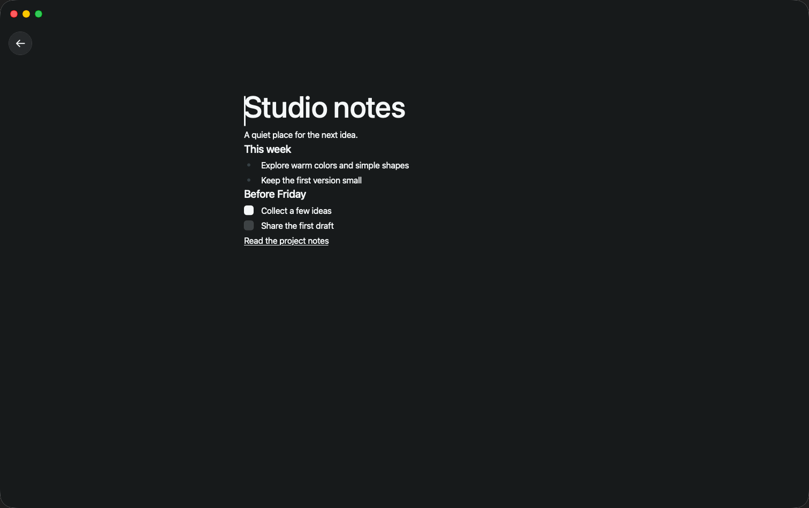
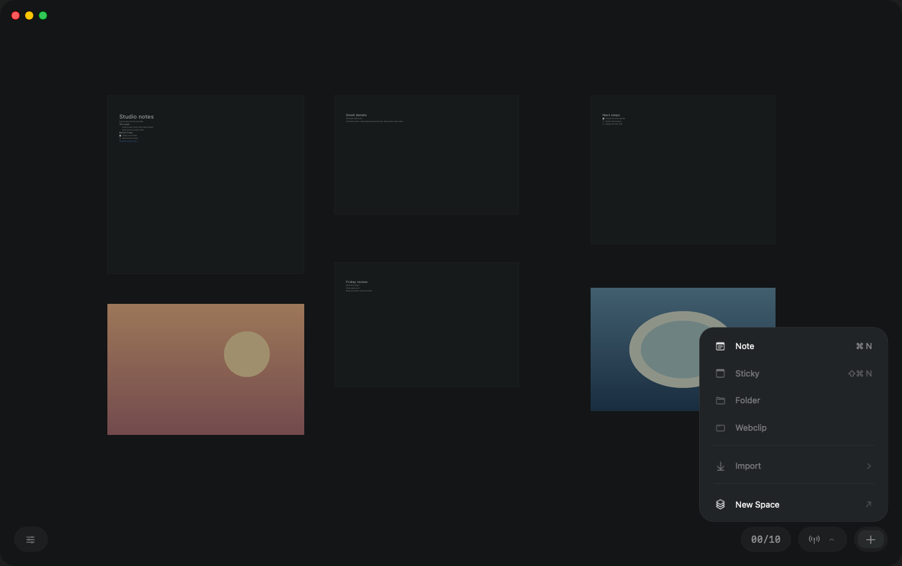
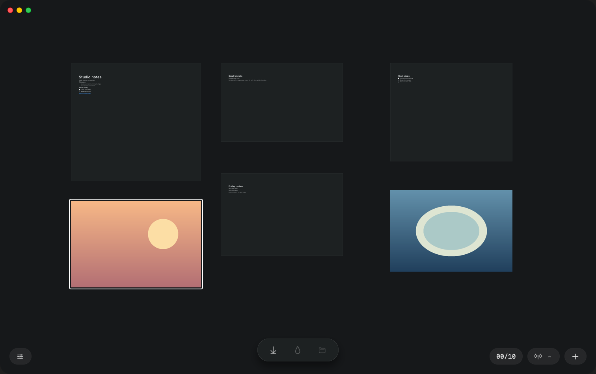

# Ray Lite

Ray Lite is a native macOS app with an infinite board for notes and images.
The canvas holds ideas, and each note opens in a full page editor.

## Screenshots


A board with note cards and two image cards.



A note with a heading, a list, a checklist, and a link.



The plus menu offers content for the board.



A selected card shows its action bar.

## What works

* Notes with a full page editor
* Text blocks, checklists, and links
* Export to Markdown
* Image cards with drag and paste
* Spaces
* Undo
* Persistence

## Not yet

* Video
* Web clips
* Bookmarks sync

## Build and Run

Requirements: macOS 15 or newer, Swift 6.2.

Build the app.

```sh
swift build
```

Run the app.

```sh
swift run RayLite
```

Run the tests.

```sh
swift test
```
